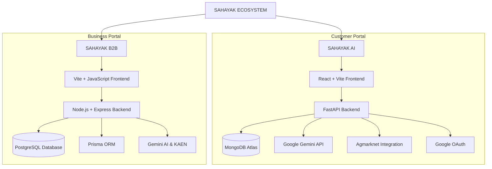

# 🌟 SAHAYAK AI
### AI Assistance for Every Profession

<p align="center">
  
</p>

<p align="center">
  <b>An AI-powered platform designed to make information, assistance, and digital services easier to access for individuals, professionals, and communities.</b>
</p>

<p align="center">
  <a href="https://sahayak-ai-customer-website.vercel.app/">
    
  </a>
  <a href="https://github.com/jayasankartanguturi/SAHAYAK-AI-CUSTOMER-WEBSITE">
    
  </a>
</p>

<p align="center">
  
  
  
  
  
  
  
</p>

---

## 📌 1. What Is Sahayak AI?

**Sahayak AI** is an intelligent digital assistance platform built to make AI useful in everyday life and across different professions.

People often need information and guidance for different tasks, but finding the right information can take time. Language barriers and limited access to digital services can make this even more difficult.

Sahayak AI aims to make these tasks easier through one platform that combines AI assistance, profession-based support, document assistance, and useful information.

### Our Main Objectives

- Make AI assistance accessible to different professions.
- Help people find useful information more easily.
- Support regional language accessibility.
- Simplify access to government scheme information.
- Provide agriculture and market-related information.
- Connect AI technology with practical, real-world needs.

**Our vision:** Make AI accessible, understandable, and useful for everyone.

---

## 🌐 2. Explore the Sahayak Ecosystem

The Sahayak ecosystem consists of two platforms with different purposes.

<details>
<summary><b>🤖 Sahayak AI – Customer Portal</b></summary>

**AI Assistance for Every Profession**

The customer portal focuses on providing AI-powered assistance and useful information to individuals, students, farmers, professionals, and communities.

- AI-powered assistance.
- Profession-based support.
- Voice, image, and document assistance.
- Government scheme information.
- Agriculture and market information.
- Multilingual support.

**Live Website:** https://sahayak-ai-customer-website.vercel.app/

**GitHub:** https://github.com/jayasankartanguturi/SAHAYAK-AI-CUSTOMER-WEBSITE

</details>

<details>
<summary><b>🏢 Sahayak B2B – Business & Trade Portal</b></summary>

**Smart Business. Better Connections. Stronger Trade.**

The B2B portal focuses on connecting buyers, retailers, wholesalers, manufacturers, suppliers, and logistics partners.

- Supplier and product discovery.
- Business connections.
- Price and MOQ comparison.
- Quotations and procurement.
- Buyer-seller negotiations.
- Order and logistics management.

**Live Website:** https://sahayak-b2b.netlify.app/

**GitHub:** https://github.com/venkatavarshith999/SAHAYAK-B2B

</details>

| Platform | Purpose | Website |
|---|---|---|
| Sahayak AI | AI assistance and profession-based support | [Visit Portal](https://sahayak-ai-customer-website.vercel.app/) |
| Sahayak B2B | Business marketplace and trade management | [Visit Portal](https://sahayak-b2b.netlify.app/) |

---

## 🎯 3. Problems We Aim to Solve

Many people and small businesses face challenges when trying to access information, digital assistance, and business opportunities.

| Problem | How Sahayak Helps |
|---|---|
| Difficulty finding reliable information | Provides AI-powered information assistance. |
| Language barriers | Supports regional language accessibility. |
| Difficulty understanding government schemes | Helps users explore scheme-related information. |
| Limited profession-specific guidance | Provides assistance based on different professional needs. |
| Difficulty understanding documents | Offers AI-based document assistance. |
| Access to agricultural information | Connects users with agriculture and market-related information. |
| Difficulty finding business suppliers | Sahayak B2B supports supplier and product discovery. |
| Complicated business procurement | Provides structured quotation and negotiation workflows. |

---

## ✨ 4. Sahayak AI – Key Features

Sahayak AI brings different forms of assistance together in one platform.

| Feature | What It Does |
|---|---|
| 🤖 AI Assistant | Answers questions and helps with everyday tasks. |
| 🎙️ Voice Assistance | Supports voice-based interaction. |
| 🖼️ Image Assistance | Helps users understand information from images. |
| 📄 Document Assistance | Helps users understand document content. |
| 👨‍🌾 Profession-Based Support | Provides guidance based on professional requirements. |
| 🏛️ Government Schemes | Helps users explore government scheme information. |
| 🌦️ Weather Information | Provides useful weather-related information. |
| 📈 Agricultural Market | Helps users access agricultural market information. |
| 🌐 Language Support | Improves accessibility through regional languages. |
| 💾 Saved Answers | Allows users to save useful AI responses. |
| 🔔 Notifications & Reminders | Helps users keep track of important updates. |
| 📚 Conversation History | Provides access to previous conversations. |

### Who Can Use Sahayak AI?

Sahayak AI is designed to support different categories of users.

- **Students:** Learning assistance, explanations, and useful information.
- **Farmers:** Agricultural information, market updates, and scheme guidance.
- **Professionals:** Work-related information and everyday assistance.
- **Small Business Owners:** Useful business information and digital assistance.
- **General Public:** Everyday questions, document assistance, and information access.
- **Rural Communities:** Accessible information and regional language support.

---

## 🏢 5. Sahayak B2B – Business & Trade Marketplace

Sahayak B2B is the business-focused platform within the Sahayak ecosystem.

It aims to simplify the way businesses find suppliers, compare products, communicate with buyers and sellers, and manage trade activities.

### Key Capabilities

- 🏪 Retailer and buyer connectivity.
- 📦 Wholesaler and supplier discovery.
- 🏭 Manufacturer connectivity.
- 🔍 Product discovery and catalogues.
- 💰 Product price comparison.
- 📊 Minimum Order Quantity (MOQ) comparison.
- 🤝 Buyer-seller communication.
- 💬 Negotiation workflows.
- 📋 Request for Quotation (RFQ).
- 🚚 Business order and trade management.

### B2B Project Links

- **Live Website:** [Sahayak B2B](https://sahayak-b2b.netlify.app/)
- **GitHub Repository:** [SAHAYAK-B2B](https://github.com/venkatavarshith999/SAHAYAK-B2B)

The B2B portal is maintained separately and has its own application architecture and repository.

---

## 🧑‍💻 6. Technology Stack

The Sahayak ecosystem uses separate technology stacks for its two portals.

### Sahayak AI – Customer Portal

| Layer | Technology |
|---|---|
| Frontend | React.js |
| Frontend Tool | Vite |
| Programming Language | JavaScript |
| Styling | CSS |
| Backend | Python |
| Backend Framework | FastAPI |
| Communication | REST APIs |
| Database | MongoDB Atlas |
| AI Integration | Google Gemini API |
| Agriculture Integration | Agmarknet |
| Authentication | Google OAuth |
| Frontend Hosting | Vercel |
| Backend Hosting | Render |

### Sahayak B2B – Business Portal

The B2B portal uses a separate architecture.

| Layer | Technology |
|---|---|
| Frontend | Vite, Vanilla JavaScript |
| Backend | Node.js, Express.js |
| Database | PostgreSQL |
| ORM | Prisma |
| AI Integration | Google Gemini |
| Authentication | Argon2id, Google OAuth |
| Deployment | Netlify |

**Important:** These are two separate applications. Their repositories, backends, databases, and deployment configurations should be managed independently.

---

## 🏗️ 7. System Architecture

The following diagram shows the high-level architecture of the Sahayak ecosystem.



### How the Customer Portal Works

1. A user interacts with the Sahayak AI frontend.
2. The frontend sends requests to the FastAPI backend.
3. The backend processes the request.
4. Required information is retrieved from the database or connected services.
5. AI-powered requests are handled through the Gemini integration.
6. The backend returns the response to the frontend.

The B2B portal follows its own business application workflow.

---

## 🔐 8. Security & Privacy

Sahayak AI includes security practices to help protect application access and user information.

- Environment-based configuration for sensitive credentials.
- Google OAuth authentication integration.
- MongoDB Atlas database connectivity.
- Backend API validation.
- CORS configuration.
- API rate limiting.
- Secure handling of application configuration.

### Security Best Practices

- Never expose API keys in frontend code.
- Never commit `.env` files to GitHub.
- Keep database credentials private.
- Use secure production environment variables.
- Restrict access to sensitive backend endpoints.

---

## ⚙️ 9. Run Sahayak AI Locally

Follow the steps below to set up the customer portal on your computer.

### Prerequisites

Install the following:

- Node.js and npm.
- Python 3.
- Git.
- MongoDB Atlas account or an appropriate MongoDB connection.
- Google Gemini API key.

### Step 1 – Clone the Repository

```bash
git clone https://github.com/jayasankartanguturi/SAHAYAK-AI-CUSTOMER-WEBSITE.git

cd SAHAYAK-AI-CUSTOMER-WEBSITE
```

### Step 2 – Install Frontend Dependencies

Open a terminal in the frontend directory:

```bash
cd frontend
npm install
```

Start the frontend development server:

```bash
npm run dev
```

### Step 3 – Set Up the Backend

Open another terminal in the project directory:

```bash
cd backend
```

Create and activate a Python virtual environment if required.

**Windows:**

```bash
python -m venv venv
venv\Scripts\activate
```

Install backend dependencies:

```bash
pip install -r requirements.txt
```

### Step 4 – Configure Environment Variables

Create the required local `.env` configuration using the environment variable names provided in the backend project.

Typical configuration categories include:

- MongoDB connection string.
- Gemini API key.
- Google OAuth credentials.
- Frontend origin and CORS settings.
- Other required backend service settings.

Use the actual variable names from the repository's environment example. Do not commit real credentials to GitHub.

### Step 5 – Start the Backend

Use the FastAPI startup command configured in the project.

For example, if the backend entry point is `app.main`:

```bash
uvicorn app.main:app --reload
```

**Note:** The backend entry point and commands may differ depending on the current project structure. Check the backend files and configuration before running this example.

---

## 🌐 10. Live Deployment

The Sahayak AI customer portal is deployed using separate frontend and backend hosting services.

| Component | Hosting Service |
|---|---|
| Customer Frontend | Vercel |
| Customer Backend | Render |
| Database | MongoDB Atlas |

### Live Project

<p align="center">
  <a href="https://sahayak-ai-customer-website.vercel.app/">
    
  </a>
</p>

**Website:** https://sahayak-ai-customer-website.vercel.app/

---

## 📸 11. Project Screenshots

Add screenshots of the actual application to help visitors understand the user interface.

Suggested screenshot structure:

```text
screenshots/
│
├── sahayak-homepage.png
├── sahayak-dashboard.png
├── sahayak-ai-assistant.png
├── sahayak-document-assistant.png
└── sahayak-b2b-portal.png
```

After adding the screenshots, display them in this section:

```markdown


```

---

## 🚀 12. Future Enhancements

We plan to expand the Sahayak ecosystem with additional capabilities.

### Customer Portal

- Advanced multilingual voice assistance.
- WhatsApp AI assistant integration.
- Phone Call IVR integration.
- More profession-specific AI services.
- Improved document understanding.
- Expert support integration.
- Additional regional information services.

### Business Portal

- Advanced AI-powered business intelligence.
- Improved supplier discovery.
- Enhanced product comparison.
- More negotiation capabilities.
- Additional logistics integrations.
- Business analytics and reporting.

**Note:** WhatsApp and Phone Call IVR are planned integrations, not features being represented as currently live.

---

## 👨‍💻 13. Project Team

| Team Member | Responsibility |
|---|---|
| **Jayasankar Tanguturi** | CTO – Sahayak AI |
| **Varshith Kundrapu** | CEO – Sahayak Ecosystem |

---

## 🤝 14. Contributing

Suggestions, feedback, and contributions are welcome.

If you want to contribute:

1. Fork the repository.
2. Create a new feature branch.
3. Make your changes.
4. Test your implementation.
5. Submit a Pull Request.

---

## 🔗 15. Official Project Links

<p align="center">
  <b>🤖 SAHAYAK AI – CUSTOMER PORTAL</b>
  <br/>
  <a href="https://sahayak-ai-customer-website.vercel.app/">🌐 Live Website</a>
  &nbsp; | &nbsp;
  <a href="https://github.com/jayasankartanguturi/SAHAYAK-AI-CUSTOMER-WEBSITE">💻 GitHub Repository</a>
</p>

<p align="center">
  <b>🏢 SAHAYAK B2B – BUSINESS PORTAL</b>
  <br/>
  <a href="https://sahayak-b2b.netlify.app/">🌐 Live Website</a>
  &nbsp; | &nbsp;
  <a href="https://github.com/venkatavarshith999/SAHAYAK-B2B">💻 GitHub Repository</a>
</p>

---

## ⭐ Support the Project

If you find Sahayak AI useful, support the project by visiting the live platforms and giving the GitHub repositories a star.

<p align="center">
  <a href="https://github.com/jayasankartanguturi/SAHAYAK-AI-CUSTOMER-WEBSITE">
    
  </a>
  <a href="https://github.com/venkatavarshith999/SAHAYAK-B2B">
    
  </a>
</p>

<p align="center">
  
</p>

<p align="center">
  <b>🌟 SAHAYAK AI × SAHAYAK B2B 🌟</b>
  <br/>
  AI Assistance • Business Connectivity • Digital Empowerment
  <br/><br/>
  <i>Building useful technology for people, professions, and businesses.</i>
</p>
