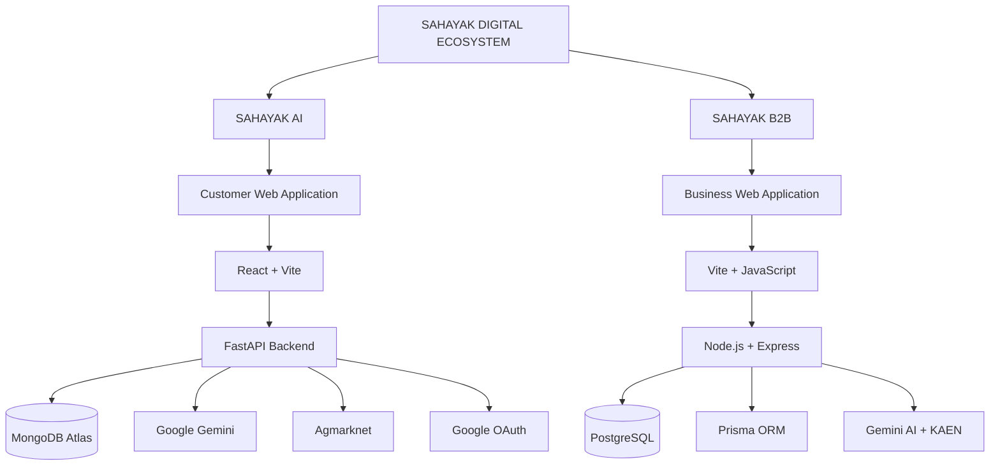

# 🌟 SAHAYAK AI
### One Ecosystem. Multiple Possibilities. AI for Everyone.

<p align="center">
  
</p>

<p align="center">
  <b>A unified digital ecosystem bringing AI assistance, professional support, useful information, and business opportunities together.</b>
</p>

<p align="center">
  <a href="https://sahayak-ai-customer-website.vercel.app/">
    
  </a>
  <a href="https://github.com/jayasankartanguturi/SAHAYAK-AI-CUSTOMER-WEBSITE">
    
  </a>
</p>

---

## 01. Introduction

### What is Sahayak AI?

Sahayak AI is an AI-powered digital assistance ecosystem designed to make technology more accessible and useful in everyday life.

The platform aims to help people get information, understand documents, explore professional guidance, and access useful digital services through a simple interface.

Instead of using different platforms for different needs, Sahayak brings multiple assistance capabilities into one ecosystem.

### Our Core Idea

**One platform that helps people, supports professions, and connects businesses.**

---

## 02. The Sahayak Ecosystem

Sahayak consists of two independent but connected platforms.

<details>
<summary><b>🤖 SAHAYAK AI — Customer Portal</b></summary>

**AI Assistance for Every Profession**

Designed for individuals, students, farmers, professionals, and communities.

Main focus:
- Intelligent AI assistance.
- Profession-based guidance.
- Voice, image, and document assistance.
- Government scheme information.
- Agricultural and market information.
- Regional language accessibility.

🌐 [Open Customer Portal](https://sahayak-ai-customer-website.vercel.app/)

💻 [Customer Portal Repository](https://github.com/jayasankartanguturi/SAHAYAK-AI-CUSTOMER-WEBSITE)

</details>

<details>
<summary><b>🏢 SAHAYAK B2B — Business Portal</b></summary>

**Smart Business. Better Connections. Stronger Trade.**

Designed to connect retailers, buyers, wholesalers, manufacturers, suppliers, and logistics partners.

Main focus:
- Business and supplier discovery.
- Product catalogues.
- Price and MOQ comparison.
- Request for Quotation (RFQ).
- Buyer-seller negotiation.
- Order and logistics management.

🌐 [Open B2B Portal](https://sahayak-b2b.netlify.app/)

💻 [B2B Repository](https://github.com/venkatavarshith999/SAHAYAK-B2B)

</details>

| Platform | Main Focus |
|---|---|
| Sahayak AI | People, professions, and AI assistance |
| Sahayak B2B | Businesses, suppliers, and digital trade |

---

## 03. The Problem

People and businesses often face difficulties accessing the right information and services.

### Challenges for Individuals

- Finding reliable information takes time.
- Language barriers make digital services difficult to access.
- Understanding government schemes can be complicated.
- Profession-specific guidance is not always easy to find.
- Understanding documents may require additional help.

### Challenges for Businesses

- Finding suitable suppliers can be difficult.
- Comparing product prices takes time.
- Minimum Order Quantity (MOQ) information may be difficult to compare.
- Negotiations can involve lengthy manual communication.
- Managing quotations, orders, and deliveries can be complicated.

### Our Solution

Sahayak addresses these challenges through two focused platforms:

- **Sahayak AI:** Makes intelligent assistance and useful information easier to access.
- **Sahayak B2B:** Simplifies business discovery, procurement, and trade workflows.

---

## 04. Sahayak AI — Features

The customer portal focuses on providing assistance through different types of user interaction.

| Capability | Description |
|---|---|
| AI Chat Assistant | Ask questions and receive AI-powered responses. |
| Voice Assistance | Interact using voice-based features. |
| Image Assistance | Get help understanding image-based information. |
| Document Assistance | Understand information contained in documents. |
| Profession-Based Assistance | Explore guidance related to different professions. |
| Government Schemes | Access scheme-related information. |
| Weather Information | Explore useful weather updates. |
| Agricultural Market | Access agricultural market-related information. |
| Language Support | Improve accessibility through regional languages. |
| Saved Answers | Keep useful responses for future reference. |
| Conversation History | Revisit previous AI conversations. |
| Notifications & Reminders | Keep track of important updates and reminders. |

### Designed for Different People

<details>
<summary>👨‍🌾 Farmers</summary>

Agricultural information, market updates, weather information, and scheme-related guidance.

</details>

<details>
<summary>🎓 Students</summary>

Learning assistance, explanations, and useful educational information.

</details>

<details>
<summary>👨‍💼 Professionals</summary>

Work-related assistance, information discovery, and everyday productivity support.

</details>

<details>
<summary>🏪 Small Business Owners</summary>

Business-related information and access to the connected Sahayak B2B ecosystem.

</details>

<details>
<summary>🌍 General Public</summary>

Everyday information, document assistance, and accessible digital support.

</details>

---

## 05. Sahayak B2B — Business Capabilities

Sahayak B2B extends the ecosystem into business and digital trade.

Its objective is to make business connections and procurement workflows easier to manage.

### Business Participants

| Participant | Purpose |
|---|---|
| Retailers | Find products and suppliers. |
| Buyers | Discover sellers and request quotations. |
| Wholesalers | Manage products and business enquiries. |
| Manufacturers | Connect with buyers and bulk orders. |
| Logistics Partners | Coordinate delivery workflows. |

### Main Capabilities

- Product and supplier discovery.
- Business profile management.
- Product catalogue management.
- Price and MOQ comparison.
- Request for Quotation (RFQ).
- Buyer-seller communication.
- Negotiation workflows.
- Order management.
- Logistics coordination.

### KAEN — Negotiation Engine

KAEN is the structured negotiation engine in the B2B platform.

It supports:
1. Buyer offer submission.
2. Seller offer review.
3. Multiple negotiation rounds.
4. Concession-based negotiation.
5. Final offer approval by both parties.

---

## 06. Technology Behind Sahayak

Sahayak uses modern web technologies, AI services, databases, and cloud deployment.

### Customer Portal

| Component | Technology |
|---|---|
| Frontend | React.js, Vite |
| Language | JavaScript |
| Styling | CSS |
| Backend | Python |
| API Framework | FastAPI |
| Database | MongoDB Atlas |
| AI | Google Gemini API |
| Agriculture Data | Agmarknet integration |
| Authentication | Google OAuth |
| Frontend Hosting | Vercel |
| Backend Hosting | Render |

### Business Portal

| Component | Technology |
|---|---|
| Frontend | Vite, Vanilla JavaScript |
| Backend | Node.js, Express.js |
| Database | PostgreSQL |
| ORM | Prisma |
| AI | Google Gemini |
| Authentication | Argon2id, Google OAuth |
| Hosting | Netlify |

**Architecture note:** The Customer Portal and B2B Portal are maintained as separate applications with separate repositories and backend architectures.

---

## 07. High-Level Architecture



### Customer Portal Request Flow

1. User opens the Sahayak AI website.
2. User enters a question or interacts with an available assistant feature.
3. The frontend sends the request to the backend.
4. The backend processes the request and connects to the required services.
5. The response is returned to the frontend.
6. The user receives the assistance.

---

## 08. Security & Responsible Development

Security is an important part of the Sahayak ecosystem.

The applications use security-related mechanisms such as:

- Environment-based configuration.
- Google OAuth integration.
- Backend request validation.
- CORS configuration.
- API rate limiting.
- Secure database connectivity.
- Protected handling of application credentials.

**Important:** API keys, passwords, OAuth secrets, and database connection strings should never be committed to public repositories.

---

## 09. Run the Customer Portal Locally

### Requirements

- Node.js and npm.
- Python 3.
- Git.
- MongoDB Atlas connection.
- Google Gemini API key.

### Step 1 — Clone the Repository

```bash
git clone https://github.com/jayasankartanguturi/SAHAYAK-AI-CUSTOMER-WEBSITE.git

cd SAHAYAK-AI-CUSTOMER-WEBSITE
```

### Step 2 — Install Frontend Dependencies

```bash
cd frontend
npm install
npm run dev
```

### Step 3 — Install Backend Dependencies

Open another terminal:

```bash
cd backend
python -m venv venv
venv\Scripts\activate
pip install -r requirements.txt
```

### Step 4 — Configure Environment Variables

Create the required `.env` configuration using the variable names provided in the project.

Configure the required credentials for:

- MongoDB Atlas.
- Google Gemini API.
- Google OAuth.
- Backend and frontend communication.
- Other required integrations.

Never upload real credentials to GitHub.

### Step 5 — Start the Backend

Use the backend startup command specified by the actual project configuration.

Example, if the application entry point is `app.main`:

```bash
uvicorn app.main:app --reload
```

**Note:** Check the repository's actual folder structure and startup configuration before using these example commands.

---

## 10. Deployment

The customer portal uses cloud services for hosting its application components.

| Application Component | Platform |
|---|---|
| Frontend | Vercel |
| Backend | Render |
| Database | MongoDB Atlas |

### Live Application

<p align="center">
  <a href="https://sahayak-ai-customer-website.vercel.app/">
    
  </a>
</p>

[Visit Sahayak AI](https://sahayak-ai-customer-website.vercel.app/)

---

## 11. Project Screenshots

Screenshots can be added to showcase the actual application interface.

Suggested structure:

```text
screenshots/
├── homepage.png
├── dashboard.png
├── ai-assistant.png
├── document-assistant.png
└── b2b-portal.png
```

Add your real application screenshots here as the project develops.

---

## 12. Future Roadmap

We aim to continuously expand the Sahayak ecosystem.

### AI & Customer Assistance
- Improved multilingual AI capabilities.
- Advanced voice assistance.
- More profession-specific tools.
- Improved image and document understanding.
- Expert support services.

### Digital Accessibility
- WhatsApp AI assistant integration.
- Phone Call IVR integration.
- More regional language services.
- Improved accessibility features.

### Business & Trade
- Enhanced supplier discovery.
- Advanced product comparison.
- Improved negotiation capabilities.
- Business intelligence and analytics.
- Additional logistics integrations.

*WhatsApp and Phone Call IVR are planned integrations, not currently advertised as live features.*

---

## 13. Project Team

| Team Member | Position |
|---|---|
| Jayasankar Tanguturi | CTO — Sahayak AI |
| Varshith Kundrapu | CEO — Sahayak Ecosystem |

---

## 14. Official Links

<p align="center">
  <b>🤖 SAHAYAK AI — CUSTOMER PORTAL</b>
  <br/><br/>
  <a href="https://sahayak-ai-customer-website.vercel.app/">
    
  </a>
  <a href="https://github.com/jayasankartanguturi/SAHAYAK-AI-CUSTOMER-WEBSITE">
    
  </a>
</p>

<p align="center">
  <b>🏢 SAHAYAK B2B — BUSINESS PORTAL</b>
  <br/><br/>
  <a href="https://sahayak-b2b.netlify.app/">
    
  </a>
  <a href="https://github.com/venkatavarshith999/SAHAYAK-B2B">
    
  </a>
</p>

---

## ⭐ Support Sahayak

If you like our vision and project, explore the platforms and support our development by starring the GitHub repositories.

<p align="center">
  
</p>

<p align="center">
  <b>🌟 SAHAYAK AI × SAHAYAK B2B</b>
  <br/>
  <i>AI Assistance • Digital Accessibility • Business Connectivity</i>
  <br/><br/>
  <b>Building a smarter and more connected digital future.</b>
</p>
